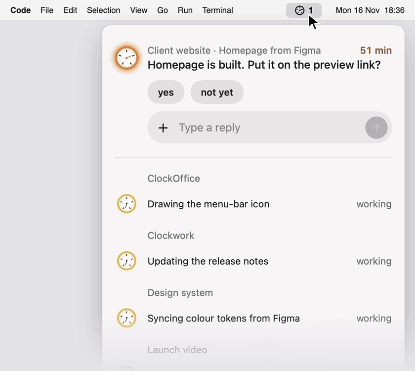
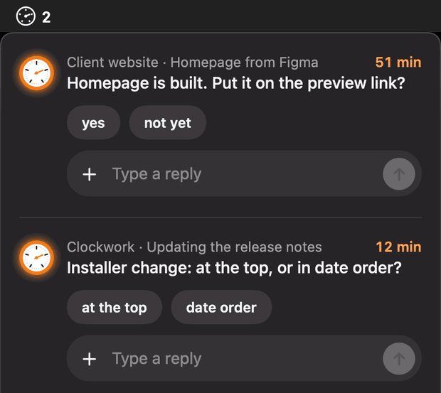
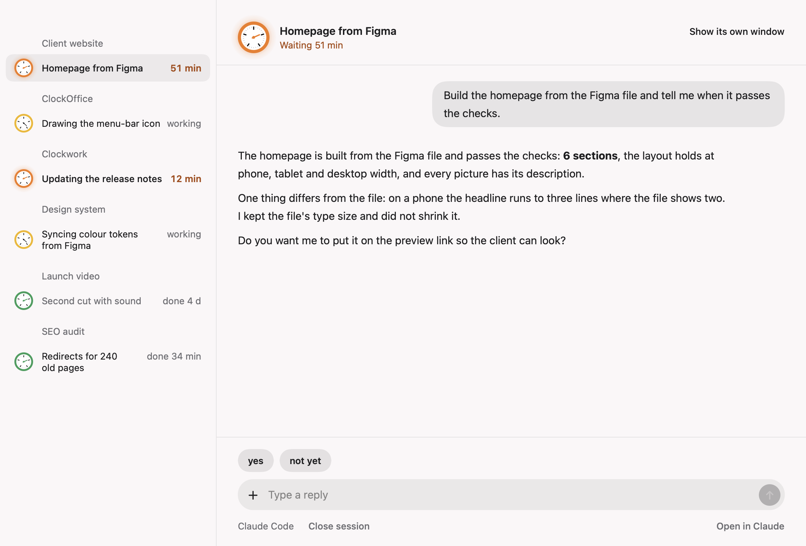

# ClockOffice

See which Claude Code session is waiting for you, and answer it from the Mac menu bar.



A coding agent stops to ask you something, and you are looking at another window. In four weeks of my own Claude Code sessions about one question in ten was never answered, and the slowest tenth waited more than twelve minutes. I counted that from the saved transcripts of my sessions, 19 October to 16 November 2026.

ClockOffice is a small Mac app for people who run several Claude Code sessions at once. It sits in the menu bar, so it is on screen whichever app you are working in, and it shows one number: how many sessions are waiting for you. Click it and you see every session, which one is waiting and what it asks, and you answer on the spot, with one click on a suggested answer or with a reply you type.

A notification tells you that something is waiting and is gone a moment later. ClockOffice sends no notifications: the number stays in the menu bar until you have answered, and the list shows the question itself.

| | Where it stands today |
|---|---|
| Replying from the app | when Claude Code runs in VS Code or an editor built on it |
| Terminal, iTerm, tmux | you see the question and jump to its window |
| Permission prompts | shown, cannot be approved from the app yet |
| Version | 0.1.0, built on your Mac with one script, used on one Mac so far |

## What you get

- Every Claude Code session on your Mac in one list, whichever window it runs in: VS Code, Cursor, Windsurf, Antigravity or a terminal.
- Your Codex conversations in the same list. You see what each one is doing and what it asks, and you answer in its own window.
- The question itself, and how long it has waited. No more opening five windows to find the one that stopped.
- An answer from the menu bar. One click when the question offers choices, a reply box when it does not.
- Your plan usage at the foot of the list, if you switch it on.
- It runs on your Mac only. No account, no telemetry.



## What the colours mean

Each session is a dial.

| Dial | Meaning |
|---|---|
| Yellow ring, the hand goes round | Working. Leave it alone. |
| Orange ring with a soft shine that breathes | It needs you: a question, or a permission. The only thing in the app that pulses. |
| Green ring, still | Finished. |
| Red ring, still | Your Claude plan's limit is used up. The Claude Code session waits until the limit resets. Shown only with "Show usage and model" switched on. |

The number next to the icon in the menu bar counts the sessions that need you.



There is a desktop widget too, in two sizes.

## Install

You need a Mac on macOS 14 or later, Claude Code, and Apple's command-line tools (`xcode-select --install`; no Xcode). Node.js is needed only if you want to reply from the app.

```sh
git clone https://github.com/marykovziridze/clockoffice
cd clockoffice
./install.sh
```

The script builds the app on your Mac, puts it in `~/Applications` and starts it. The first build takes under two minutes on my Mac. Then its icon appears in your menu bar.

There is no download to double-click. I don't sign the app with an Apple developer certificate, so macOS would stop a ready-made copy. An app you build yourself runs.

To reply from the app, right-click the icon in the menu bar and choose "Set up replying in …". That installs a small extension in the editor that hosts your sessions. Without it you still see every question and jump to its window in one click.

Keyboard shortcuts, the widget and how to remove everything: [mac/README.md](mac/README.md).

## What it does on your machine

- It reads Claude Code's own session files in `~/.claude/` to know which sessions exist and what each is doing.
- If you use Codex, it reads Codex's conversation files in `~/.codex/sessions/` the same way. It writes nothing there, changes no Codex setting, and what it reads stays on your Mac.
- On by default: for an idle session it asks a small model, through your own Claude Code and inside your own plan, whether the last message ends on a question, and to write the one-line summary. About 2,000 tokens per message. Only Claude Code text goes there; a Codex conversation is never sent. Switch it off in the menu ("Summaries in plain words") and fixed wording rules do the job.
- Off by default: "Show the words of Claude Code dialogs" and "Show usage and model" each add an entry to `~/.claude/settings.json` and keep a backup.
- It listens on `127.0.0.1` only (port 47863), for its own widget and those optional entries.
- The editor extension types your reply, plus one Enter, into that session's own terminal. Never into whichever terminal happens to be active.
- Close the app and your sessions behave exactly as they did without it.

More: [PRIVACY.md](PRIVACY.md).

## Not proven yet

- Version 0.1.0. So far it has run on my Mac only (macOS 26.5, Apple silicon).
- It reads Claude Code's session files, and Claude Code does not promise to keep their format. An update can break it.
- Mac only.

## Tests

```sh
cd mac && swift test                        # the logic
cd app && npm ci && npm run test:ext        # the editor extension, in an isolated copy of VS Code
```

`ClockOffice --render <folder>` draws every screen to PNG with sample sessions. The pictures on this page are made from those renders; in the first one, the menu bar and the pointer around the app are drawn.

## Related

[Clockwork](https://github.com/marykovziridze/clockwork) keeps parallel Claude Code sessions from overwriting each other's work. ClockOffice shows you which of them is waiting for you. Same dial.

## License

MIT. Provided as is, without support.

Made by [Mary Kovziridze](https://github.com/marykovziridze).
